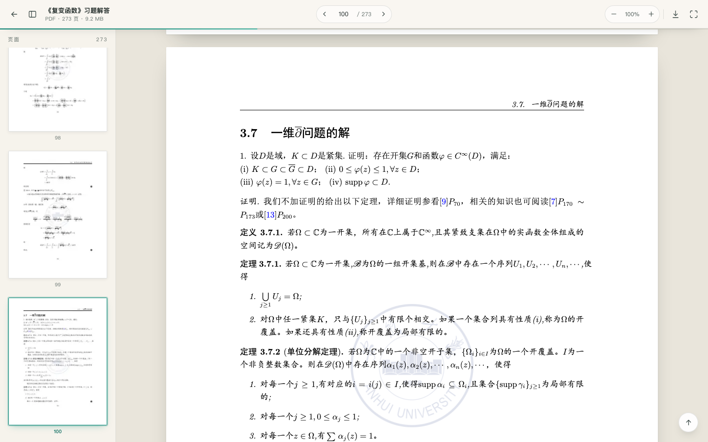

# 《复变函数》习题解答 · 网页阅读版

把 `Latex.pdf`（273 页，9.2 MB）放进一个静态网页：访问首页，点击「在线阅读」，即可用 **pdf.js** 在浏览器里直接翻阅，无需下载，也无需安装任何插件。

## 预览




## 快速开始

**方式一（macOS 推荐）**：双击 `serve.command`。它会自动启动本地服务器并打开浏览器。关闭终端窗口即可停止。

**方式二（命令行）**：

```bash
cd "这个文件夹"
python3 -m http.server 8000
```

然后访问 <http://localhost:8000>。

> ⚠️ 请勿直接双击 `index.html` / `viewer.html`。`file://` 协议下浏览器禁止网页读取本地 PDF，pdf.js 会加载失败——页面里对此也有提示。

## 页面结构

```
.
├── index.html                # 首页：文档介绍 + 超链接入口
├── viewer.html               # 阅读器：pdf.js 渲染、缩略图、缩放、跳页
├── Latex.pdf                 # 原始 PDF（阅读器加载的就是它）
├── serve.command             # 一键启动本地服务器（macOS）
├── assets/
│   ├── css/
│   │   ├── base.css          # 设计变量与基础样式
│   │   ├── site.css          # 首页样式
│   │   └── viewer.css        # 阅读器样式
│   ├── js/viewer.js          # 阅读器逻辑
│   ├── img/cover.webp        # 首页封面图
│   └── vendor/pdfjs/         # pdf.js 4.10.38（本地引入，离线可用）
├── preview/                  # 截图预览（可删除，不影响运行）
└── README.md
```

## 功能

- **首页超链接**：主按钮、右上角入口、封面图都可以点击进入阅读器。
- **连续滚动 + 懒加载**：只渲染可视区域附近的页面，273 页也能流畅翻阅；离开视口的页面画布会自动释放内存。
- **页面缩略图**：左侧边栏按需生成缩略图，当前页高亮，点击即可跳转。
- **缩放**：`50%`–`325%`，支持 `Ctrl/⌘ + 滚轮` 或触控板双指缩放；点击百分比恢复「适应宽度」。
- **页码直达**：顶部输入框输入页码回车；地址栏支持深链接，例如 `viewer.html#page=42`。
- **文本选择**：通过 pdf.js 的文本层，可直接选中、复制页面文字。
- **文档内链接**：PDF 中的目录 / 交叉引用链接可以点击跳转。
- **移动端适配**：工具栏自适应，缩略图变为抽屉，页面随屏幕宽度缩放。
- **全屏阅读**：`F` 键或右上角按钮。

## 键盘快捷键

| 按键 | 功能 |
| --- | --- |
| `→` / `PageDown` | 下一页 |
| `←` / `PageUp` | 上一页 |
| `Home` / `End` | 第一页 / 最后一页 |
| `+` / `-` | 放大 / 缩小 |
| `0` | 恢复适应宽度 |
| `F` | 全屏切换 |
| `Esc` | 关闭缩略图抽屉 |

## 部署到线上

这是一个纯静态站点，把整个文件夹上传到任意静态托管即可，无需后端：

- GitHub Pages：推送到仓库后在 Settings → Pages 中选择分支目录。
- Netlify / Vercel / Cloudflare Pages：拖拽文件夹或连接仓库，构建命令留空，输出目录为根目录。
- 自己的服务器：放到 Nginx / Apache 的站点目录即可。

部署后把首页链接分享出去，访问者点击「在线阅读」就能打开阅读器。

> 注意：服务器需要正确返回 `.mjs` 的 JavaScript MIME 类型（`text/javascript`），主流静态托管都默认支持。

## 替换 PDF

1. 用新的 PDF 覆盖 `Latex.pdf`（或修改 `assets/js/viewer.js` 顶部的 `PDF_URL`）。
2. 首页文案中的页数、大小、版本号写在 `index.html` 里，按需修改。
3. 封面图位于 `assets/img/cover.webp`，可替换为新 PDF 的第一页截图。

## 技术说明

- 渲染引擎：[pdf.js](https://mozilla.github.io/pdf.js/) 4.10.38（`pdf.min.mjs` + `pdf.worker.min.mjs`，随项目本地托管，不依赖 CDN）。
- 页面使用 Canvas 渲染，叠加 pdf.js 文本层与链接注解层；缩放时按 `devicePixelRatio` 重新渲染以保证清晰度。
- 阅读位置会同步到 URL 的 `#page=N`，刷新或分享链接可直达同一页。
- 浏览器要求：Chrome / Edge 119+、Safari 17.4+、Firefox 121+（pdf.js 4.x 使用了较新的 Web 平台特性）。

## 许可

文档内容采用 [知识共享署名 4.0 国际许可协议](https://creativecommons.org/licenses/by/4.0/deed.zh-hans) 进行许可。
